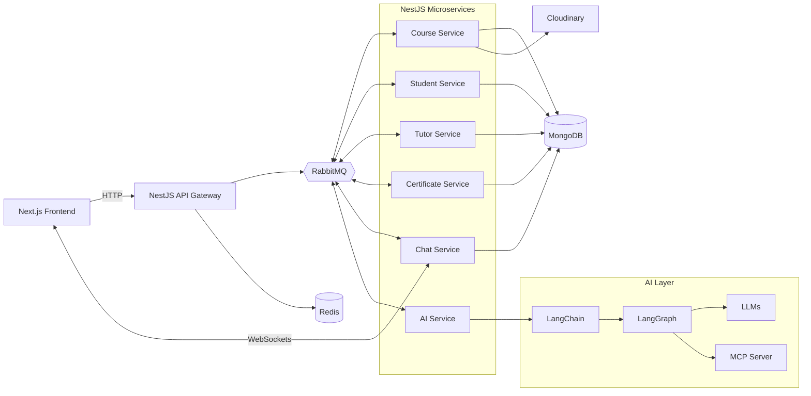

<div align="center">


<svg xmlns="http://www.w3.org/2000/svg" viewBox="0 0 128 128" width="128" height="128">
  <defs>
    <linearGradient id="ujyalo" x1="0" y1="0" x2="1" y2="1">
      <stop offset="0%" stop-color="#F59E0B"/>
      <stop offset="100%" stop-color="#EA580C"/>
    </linearGradient>
  </defs>
  <rect width="128" height="128" rx="30" fill="#172554"/>
  <circle cx="64" cy="48" r="25" fill="url(#ujyalo)"/>
  <path d="M64 12 V5 M64 91 V83 M28 48 H20 M108 48 H100 M38 22 L32 16 M90 22 L96 16"
        stroke="#FDE68A" stroke-width="4" stroke-linecap="round"/>
  <path d="M22 73 Q43 64 64 82 Q85 64 106 73 V94 Q85 86 64 101 Q43 86 22 94 Z"
        fill="#FFFFFF"/>
  <path d="M64 82 V101" stroke="#F59E0B" stroke-width="3" fill="none"/>
</svg>


# Ujyalo

**Illuminate Your Learning.**

An AI-powered Learning Management System built with an Nx monorepo, Next.js, and NestJS microservices.

<br />


<br />


</div>

---

> [!NOTE]
> 🚧 **Currently in Development.** Ujyalo is under active development. Features, APIs, and architecture may change, and the project is not yet production-ready.

## 📖 About

Ujyalo is a Learning Management System that combines traditional course and learner management with AI-assisted discovery and learning. Students can find courses and instructors using natural language, ask an AI assistant for explanations, and chat directly with their instructors.

The backend is a set of NestJS microservices that communicate asynchronously through RabbitMQ, all managed in a single Nx monorepo.

## ✨ Features

| Feature | Description | Status |
| --- | --- | --- |
| 🔎 **AI course discovery** | Find relevant courses using natural language | 🚧 In development |
| 🧑‍🏫 **AI instructor discovery** | Match students with instructors by interests and learning needs | 🚧 In development |
| 🤖 **AI learning assistant** | Ask questions and get AI-generated explanations | 🚧 In development |
| 💬 **Student–instructor chat** | Real-time direct messaging over WebSockets | 🚧 In development |
| 🎓 **Management workflows** | Courses, students, tutors, and certificates | 🚧 In development |
| 🧩 **Microservice backend** | Message-driven services communicating via RabbitMQ | 🚧 In development |

<!-- VERIFY: update each status to ✅ Available as features are completed. -->

## 🧰 Tech Stack

| Layer | Technologies |
| --- | --- |
| **Monorepo** | Nx, npm |
| **Frontend** | Next.js, React, Tailwind CSS |
| **Backend** | NestJS, TypeScript |
| **Data** | MongoDB with Mongoose, Redis (sessions and caching) |
| **Messaging** | RabbitMQ |
| **Real-time** | WebSockets |
| **AI** | LLMs, LangChain, LangGraph, MCP server integration |
| **Media** | Cloudinary |
| **Infrastructure** | Docker, Docker Compose |

## 🏗️ Architecture



<!-- VERIFY: service names, which services use Redis/Cloudinary/Mongo, and the WebSocket host service are inferred from the feature list. Adjust to match the actual code. -->

## 📁 Project Structure

```text
ujyalo/
├── apps/          # Next.js frontend and NestJS applications
├── libs/          # Shared libraries
├── assets/        # Logo and static README assets
├── nx.json
└── package.json
```

<!-- VERIFY: list actual app and lib names from the repository. -->

## 🚀 Getting Started

### Prerequisites

- Node.js and npm
- Docker and Docker Compose

### Installation

```bash
git clone <your-repository-url>
cd ujyalo
npm install
```

### Configuration

<!-- VERIFY: document the real environment file and variables (e.g. from .env.example). None are listed here to avoid inaccuracies. -->

Create the required environment files for MongoDB, Redis, RabbitMQ, Cloudinary, and your LLM provider as described in the repository's example env files.

### Run

```bash
# Start infrastructure and services (verify the Compose file path and service names)
docker compose up -d

# Serve an individual app with Nx (replace <app-name> with a project from apps/)
npx nx serve <app-name>
```

<!-- VERIFY: replace with the exact commands/scripts defined in package.json and project.json files. -->

## 🗺️ Roadmap

- [ ] 🔎 AI course discovery
- [ ] 🧑‍🏫 AI instructor discovery
- [ ] 🤖 AI learning assistant
- [ ] 💬 Student–instructor real-time chat
- [ ] 🎓 Course, student, tutor, and certificate workflows
- [ ] 🧪 Testing and CI/CD
- [ ] 🚢 Production deployment

<!-- VERIFY: tick items that are complete and add or remove items to match your plans. -->

## 📄 License

A license has not yet been specified for this project.

<!-- VERIFY: if a LICENSE file exists in the repository, replace this section with its name and a link. -->

---

<div align="center">

**Ujyalo** · Illuminate Your Learning.

</div>
