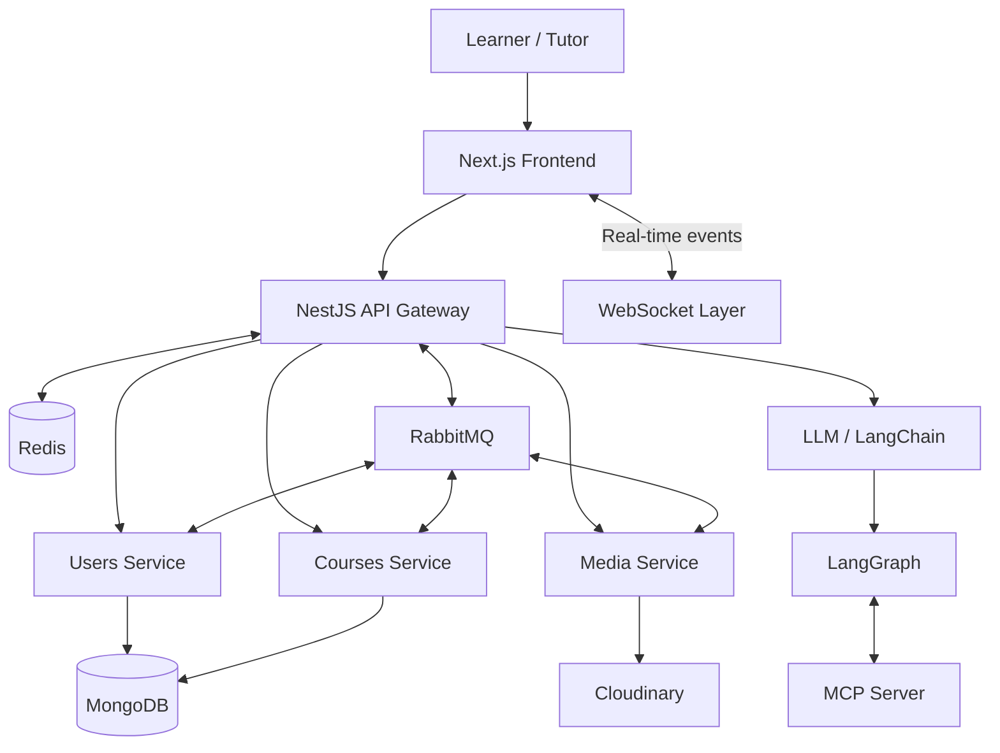

 <div align="center">

  

  # Sikai — सिकाइ

  ### Learn Smarter. Grow Together.

  **An AI-powered Learning Management System**

  <p>
    
    
    
    
  </p>

  **Empowering learning through technology, intelligence, and innovation.**

</div>

---

> [!WARNING]
> **Sikai is currently under active development.**
>
> Features, APIs, architecture, and setup instructions are subject to change. This project is not yet a production-ready release.

## About Sikai

**Sikai (सिकाइ)** means *learning* in Nepali. It represents a vision of making education more accessible, interactive, and intelligent through modern web technologies and artificial intelligence.

Sikai is a Learning Management System (LMS) being developed using **Next.js, NestJS, and Nx**, with a microservices-based backend architecture.

Beyond traditional learning management, the project explores AI-powered learning experiences using Large Language Models (LLMs), LangChain, LangGraph, and the Model Context Protocol (MCP).

The goal is to build a scalable platform that brings together students, tutors, courses, real-time communication, and intelligent learning tools.

## ✨ Key Features & Goals

- 🎓 **Learning Management:** Course, student, tutor, and certificate workflows.
- 🤖 **AI-Powered Learning:** Explore LLM-powered assistance and intelligent learning workflows.
- 🧠 **AI Agents:** Build agentic workflows with LangChain and LangGraph.
- 🔌 **MCP Integration:** Connect AI workflows to tools and external capabilities through MCP servers.
- ⚡ **Real-Time Communication:** WebSockets for interactive, real-time experiences.
- 🔐 **Session Management:** Redis-backed sessions and fast data access.
- 📨 **Asynchronous Messaging:** RabbitMQ for communication between backend services.
- ☁️ **Cloud Media Storage:** Cloudinary integration for image and media uploads.
- 🏗️ **Microservices Architecture:** Separate backend services with clear responsibilities.
- 🐳 **Containerized Infrastructure:** Docker for local development and supporting services.
- 📦 **Monorepo Development:** Nx for organizing frontend, backend applications, and shared libraries.

*These are project goals and integrations; implementation and completion may vary while development continues.*

## 🛠️ Tech Stack

| Category | Technologies |
|---|---|
| Monorepo | Nx |
| Frontend | Next.js, React, Tailwind CSS |
| Backend | NestJS, Node.js, TypeScript |
| Database | MongoDB, Mongoose |
| Caching & Sessions | Redis |
| Message Broker | RabbitMQ |
| AI & LLM | LLMs, LangChain, LangGraph |
| AI Tool Integration | Model Context Protocol (MCP) |
| Real-Time | WebSockets |
| Media Management | Cloudinary |
| Infrastructure | Docker, Docker Compose |
| Package Manager | npm |

## 🏛️ System Architecture

Sikai uses an Nx monorepo to organize the frontend and backend services within a unified workspace.



*This diagram illustrates the intended high-level design and may differ from the current implementation.*

### Why this architecture?

- **Nx** — manages multiple applications and shared libraries in one repository.
- **Next.js** — powers the frontend experience.
- **NestJS** — provides a modular backend and microservice infrastructure.
- **MongoDB** — stores application data.
- **Redis** — supports session storage and caching.
- **RabbitMQ** — enables asynchronous communication between services.
- **LangChain & LangGraph** — provide building blocks for LLM applications and agent workflows.
- **MCP** — enables AI applications to interact with supported tools and resources.
- **WebSockets** — enable bidirectional, real-time communication.
- **Cloudinary** — manages cloud-hosted media.
- **Docker** — simplifies local infrastructure setup.

## 📂 Project Structure

The following is an illustrative structure. Adjust it to match the actual applications and libraries in your repository.

```text
sikai/
├── apps/
│   ├── web/                  # Next.js frontend
│   └── api/
│       ├── gateway/          # API gateway
│       ├── users/             # User microservice
│       ├── courses/           # Course microservice
│       └── media/             # Media microservice
├── libs/                      # Shared libraries and clients
├── assets/
│   └── logo.svg               # Project logo
├── docker-compose.yml         # Local infrastructure
├── nx.json
├── package.json
├── tsconfig.base.json
└── README.md
```

## 🚀 Getting Started

### Prerequisites

Make sure you have the following installed:

- [Node.js](https://nodejs.org/)
- [npm](https://docs.npmjs.com/)
- [Docker Desktop](https://www.docker.com/products/docker-desktop/)
- A MongoDB instance or MongoDB Atlas account
- Cloudinary credentials if testing media uploads
- API credentials for your configured LLM provider

### 1. Clone the repository

```bash
git clone <your-repository-url>
cd <your-repository-folder>
```

### 2. Install dependencies

```bash
npm install
```

### 3. Configure environment variables

Create the required `.env` files for the applications and services that need them.

Typical configuration includes:

- MongoDB connection URI
- Redis connection settings
- RabbitMQ connection URL and queue names
- Cloudinary credentials
- LLM provider API keys and model settings
- Session configuration
- MCP server configuration, where required

Use your existing service configuration as the source of truth. Do not commit secrets or real `.env` files to Git.

### 4. Start infrastructure

If your repository includes a Docker Compose configuration:

```bash
docker compose up -d
```

Check the Compose file to see which services are configured and which ports they expose.

### 5. Run the applications

First, inspect the projects available in your Nx workspace:

```bash
npx nx show projects
```

You can run a configured project with:

```bash
npx nx serve <project-name>
```

Alternatively, use the development scripts defined in your root `package.json`, for example:

```bash
npm run dev:web
npm run dev:gateway
npm run dev:users
npm run dev:courses
```

These example scripts must exist in your repository before you can use them. Start the required dependencies and services according to your configuration.

## 🗺️ Development Roadmap

Sikai is a work in progress. The roadmap will evolve as features are implemented and tested.

- [ ] Complete core student and tutor workflows
- [ ] Develop course management functionality
- [ ] Finalize authentication and session management
- [ ] Complete media upload integration
- [ ] Improve inter-service communication
- [ ] Expand real-time communication features
- [ ] Integrate AI-powered learning assistance
- [ ] Develop LangGraph agent workflows
- [ ] Integrate MCP tools and resources
- [ ] Add comprehensive testing and validation
- [ ] Improve logging, monitoring, and error handling
- [ ] Prepare deployment and production infrastructure

## 🔒 Security

Security is an important part of Sikai's development.

- Keep API keys and credentials in environment variables.
- Never commit session secrets or database credentials.
- Validate and sanitize incoming requests.
- Apply authentication and authorization to protected endpoints.
- Restrict AI tools and MCP integrations to explicitly permitted operations.
- Protect user data and uploaded media.

## 🤝 Contributing

Sikai is currently under development. Contributions, ideas, and constructive feedback are welcome.

1. Open an issue to discuss a proposed change.
2. Fork the repository and create a feature branch.
3. Make focused changes consistent with the existing Nx workspace.
4. Run the available checks and tests.
5. Submit a pull request describing your changes.

Please avoid sharing credentials, personal information, or sensitive security details in public issues.

## 📄 License

A license has not yet been specified. Until a license is added to the repository, do not assume that the project is available for unrestricted reuse or distribution.

---

<div align="center">

  **सिकाइ — Learn today. Build tomorrow.**

  *Proudly inspired by the Nepali spirit of learning and growth.*

  **Status: Currently in Development 🚧**

</div>
