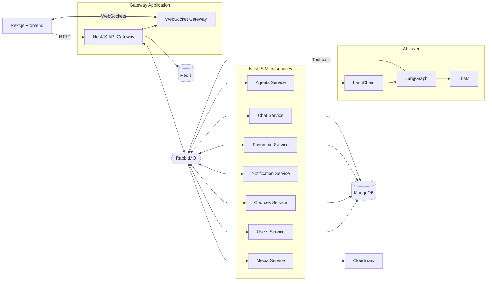

<div align="center">

<svg xmlns="http://www.w3.org/2000/svg" viewBox="0 0 128 128" width="128" height="128">
  <defs>
    <linearGradient id="ujyalo" x1="0" y1="0" x2="1" y2="1">
      <stop offset="0%" stop-color="#F59E0B"/>
      <stop offset="100%" stop-color="#EA580C"/>
    </linearGradient>
  </defs>
  <rect width="128" height="128" rx="30" fill="#172554"/>
  <circle cx="64" cy="48" r="25" fill="url(#ujyalo)"/>
  <path d="M64 12 V5 M64 91 V83 M28 48 H20 M108 48 H100 M38 22 L32 16 M90 22 L96 16"
        stroke="#FDE68A" stroke-width="4" stroke-linecap="round"/>
  <path d="M22 73 Q43 64 64 82 Q85 64 106 73 V94 Q85 86 64 101 Q43 86 22 94 Z"
        fill="#FFFFFF"/>
  <path d="M64 82 V101" stroke="#F59E0B" stroke-width="3" fill="none"/>
</svg>

# Ujyalo

**Illuminate Your Learning.**

An AI-powered Learning Management System built with an Nx monorepo, Next.js, and NestJS microservices.


</div>

---

> [!NOTE]
> ✅ **Ready.** Ujyalo is ready to use. Check the configuration section below before deploying, since some settings (such as the eSewa test mode and unpaid enrollment) are development-only.

## 📖 About

Ujyalo is a Learning Management System that combines traditional course and learner management with AI-assisted discovery and learning. Students can find courses and instructors using natural language, ask an AI assistant for explanations, and chat directly with their instructors.

The backend consists of eight NestJS applications: a gateway, users, notification, courses, payments, agents, chat, and media. These applications are managed in a single Nx monorepo and communicate through RabbitMQ where appropriate. The gateway also hosts the WebSocket gateway for real-time communication.

## ✨ Features

| Feature | Description | Status |
| --- | --- | --- |
| 🔎 **AI course discovery** | Find relevant courses using natural language | ✅ Ready |
| 🧑‍🏫 **AI instructor discovery** | Match students with instructors by interests and learning needs | ✅ Ready |
| 🤖 **AI learning assistant** | Ask questions and get AI-generated explanations | ✅ Ready |
| 💬 **Student–instructor chat** | Real-time direct messaging over WebSockets | ✅ Ready |
| 🎓 **Management workflows** | Courses, students, tutors, and certificates | ✅ Ready |
| 🧩 **Microservice backend** | Message-driven services communicating via RabbitMQ | ✅ Ready |

## 🧰 Tech Stack

| Layer | Technologies |
| --- | --- |
| **Monorepo** | Nx, npm |
| **Frontend** | Next.js, React, Tailwind CSS |
| **Backend** | NestJS, TypeScript |
| **Data** | MongoDB with Mongoose, Redis (sessions and caching) |
| **Messaging** | RabbitMQ |
| **Real-time** | WebSockets |
| **AI** | LLMs, LangChain, LangGraph |
| **Media** | Cloudinary |
| **Infrastructure** | Docker, Docker Compose |

## 🏗️ Architecture



## 📁 Project Structure

```text
ujyalo/
├── apps/
│   ├── web/                 # Next.js frontend
│   └── api/
│       ├── gateway/         # HTTP API and WebSocket gateway
│       ├── users/           # User management and authentication
│       ├── notification/    # Email and notification workflows
│       ├── courses/         # Course management
│       ├── payments/        # Payment processing
│       ├── agents/          # AI agents and LangGraph workflows
│       ├── chat/            # Chat service
│       └── media/           # Media uploads and Cloudinary
├── libs/                    # Shared libraries and modules
├── assets/                  # Logo and static README assets
├── nx.json
└── package.json
```

## 🚀 Getting Started

### Prerequisites

- Node.js and npm
- Docker and Docker Compose

### Installation

```bash
git clone <your-repository-url>
cd ujyalo
npm install
```

### Configuration

Create the required environment files for MongoDB, Redis, RabbitMQ, Cloudinary, and your LLM provider as described in the repository's example env files.

For administrator sign-in, add `ADMIN_EMAIL` and `ADMIN_PASSWORD` from `apps/api/users/.env.example` to the users service environment (`apps/api/users/.env`). Use a unique, strong password. These values are read only by the users service; do not add `NEXT_PUBLIC_` prefixes or commit actual credentials. Admin sign-in is disabled when either value is missing.

For development eSewa checkout, configure the payments service with the test credential `ESEWA_SECRET` and `ESEWA_ENV=test`. It uses product code `EPAYTEST`, form endpoint `https://rc-epay.esewa.com.np/api/epay/main/v2/form`, and status endpoint `https://rc.esewa.com.np/api/epay/transaction/status/`; production eSewa settings are intentionally not supported. Never expose `ESEWA_SECRET` to the web app. The gateway exposes authenticated `POST /api/payments/initiate` and `POST /api/payments/verify` routes. The web app uses its configured `/api` rewrite (`NEXT_PUBLIC_BACKEND_URL`) to reach the gateway.

For local development only, unpaid enrollment after a failed eSewa verification is disabled by default. To enable it, set `NODE_ENV=development` and `ALLOW_UNPAID_ENROLLMENT=true` in both the gateway and users service environments. The server still requires a valid payment attempt belonging to the signed-in student, and the users service independently enforces this development-only setting. The payment record keeps its actual status; the enrollment is labeled as a development enrollment. Development enrollments can participate in chat only while this development-only setting is enabled in both services. Never enable this setting in production.

Student–instructor chat runs through the API gateway’s Socket.IO endpoint and the existing chat microservice. The browser reuses the authenticated, HTTP-only `token` cookie; it does not send user IDs or session secrets. Set `WEB_ORIGIN` on the gateway to the comma-separated web origins allowed to connect (for local development, `http://localhost:3000`) and set `NEXT_PUBLIC_CHAT_SOCKET_URL` to the gateway origin when it differs from `NEXT_PUBLIC_BACKEND_URL` (for local development, `http://localhost:8000`; otherwise the client strips the `/api` suffix). Chat contacts are derived from shared saved course enrollments. Development-bypass enrollments qualify only when `NODE_ENV=development` and `ALLOW_UNPAID_ENROLLMENT=true` are configured on both the gateway and users service.

### Run

```bash
# Start infrastructure and services
docker compose up -d

# Serve an individual app with Nx
npx nx serve <app-name>
```

## 🗺️ Roadmap

- [ ] 🔎 AI course discovery
- [ ] 🧑‍🏫 AI instructor discovery
- [ ] 🤖 AI learning assistant
- [x] 💬 Student–instructor real-time chat
- [ ] 🎓 Course, student, tutor, and certificate workflows
- [ ] 🧪 Testing and CI/CD
- [ ] 🚢 Production deployment

## 📄 License

A license has not yet been specified for this project.

---

<div align="center">

**Ujyalo** · Illuminate Your Learning.

</div>
